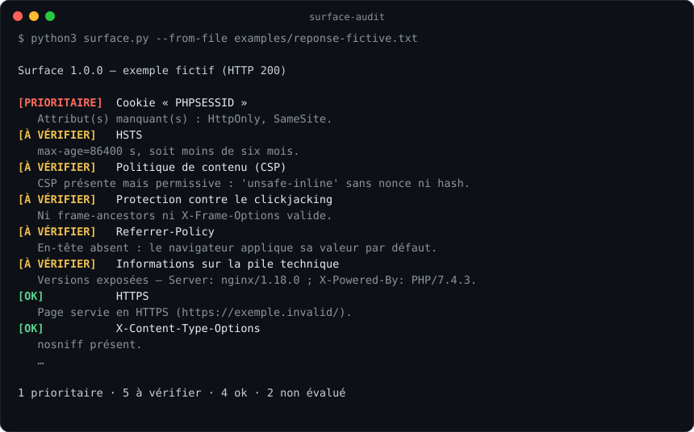

# Surface

[](https://github.com/NicolasJaumotte/surface-audit/actions/workflows/tests.yml)


**Un domaine. Des observations. Des actions à prioriser.**

Surface est un outil d’audit web **passif** écrit en Python. Il envoie une requête GET ordinaire vers la page d’accueil d’un domaine, lit les en-têtes de la réponse et produit un rapport classé : ce qui pose problème, ce qu’il faut vérifier, ce qui est en place et ce qu’une réponse HTTP ne permet pas d’évaluer.



## Essayer en 10 secondes

```sh
git clone https://github.com/NicolasJaumotte/surface-audit.git
cd surface-audit
python3 surface.py --from-file examples/reponse-fictive.txt   # hors ligne, exemple fictif
python3 surface.py github.com                                  # un vrai domaine
python3 surface.py github.com --format markdown > rapport.md   # rapport à partager
```

Aucune installation : seulement la bibliothèque standard de Python 3.9+. Formats disponibles : `text`, `markdown`, `json`. Le code retour vaut `1` s’il y a au moins un point prioritaire, ce qui permet de brancher Surface dans une CI.

## Ce que Surface contrôle

| Contrôle | Ce qui est regardé | Pourquoi |
| --- | --- | --- |
| HTTPS et redirection | URL finale, réponse de `http://` | Sans HTTPS, tout le reste est contournable. |
| HSTS | `Strict-Transport-Security`, durée de `max-age` | Empêche le retour vers HTTP après la première visite. |
| CSP | `script-src` / `default-src`, `'unsafe-inline'` sans nonce, `'unsafe-eval'`, sources trop larges, mode Report-Only | Limite l’impact d’une faille XSS. |
| Clickjacking | `frame-ancestors`, `X-Frame-Options` | Empêche l’intégration du site dans une page piège. |
| Type MIME | `X-Content-Type-Options: nosniff` | Évite l’interprétation d’un fichier comme script. |
| Referrer-Policy | valeurs permissives | Évite de transmettre des URL internes à des tiers. |
| CORS | `*` combiné à `Allow-Credentials: true` | Configuration qui expose des données authentifiées. |
| Cookies | `Secure`, `HttpOnly` (cookies de session), `SameSite` | Vol de session, CSRF. |
| Pile technique | versions dans `Server`, `X-Powered-By` | Facilite la recherche de vulnérabilités connues. |

Exemple de rapport complet : [`examples/rapport-fictif.md`](examples/rapport-fictif.md).

## Ce que Surface ne fait pas

Un en-tête absent ne prouve pas qu’un site est exploitable ; sa présence ne garantit pas sa sécurité. Les injections SQL, les XSS ou le contrôle d’accès ne se voient pas dans une réponse HTTP : ils se vérifient dans le code ou par un test dans un environnement autorisé. Surface le signale dans chaque rapport au lieu de le passer sous silence.

Surface n’envoie qu’une requête GET (plus une vers `http://` pour tester la redirection), comme un navigateur qui ouvre la page. Pas de fuzzing, pas de scan de ports, pas de charge utile.

## Comment c’est construit

- `surface.py` — un seul fichier, découpé en quatre parties : modèle (`Response`, `Finding`), contrôles, collecte, rapports.
- Chaque contrôle est une **fonction pure** `Response -> Finding` : facile à tester sans réseau et à étendre (ajouter une fonction à `CHECKS`).
- Les redirections sont suivies à la main pour garder la chaîne complète dans le rapport.
- `tests/` — 21 tests `unittest` hors ligne, exécutés par GitHub Actions sur Python 3.9, 3.11 et 3.13.

```sh
python3 -m unittest discover -s tests -v
```

## Pistes d’évolution

- Lire plusieurs domaines depuis un fichier et produire un tableau comparatif.
- Contrôler le certificat TLS (date d’expiration, émetteur).
- Suivre l’évolution d’un domaine dans le temps (rapport JSON versionné).

## Références

[OWASP — en-têtes de sécurité HTTP](https://cheatsheetseries.owasp.org/cheatsheets/HTTP_Headers_Cheat_Sheet.html) · [OWASP — prévention des injections SQL](https://cheatsheetseries.owasp.org/cheatsheets/SQL_Injection_Prevention_Cheat_Sheet.html) · [MDN — cookies HTTP](https://developer.mozilla.org/fr/docs/Web/HTTP/Cookies)

---

Projet personnel de [Nicolas Jaumotte](https://www.linkedin.com/in/nicolas-jaumotte-71743a399/), étudiant à l’EPITA. Licence MIT.
